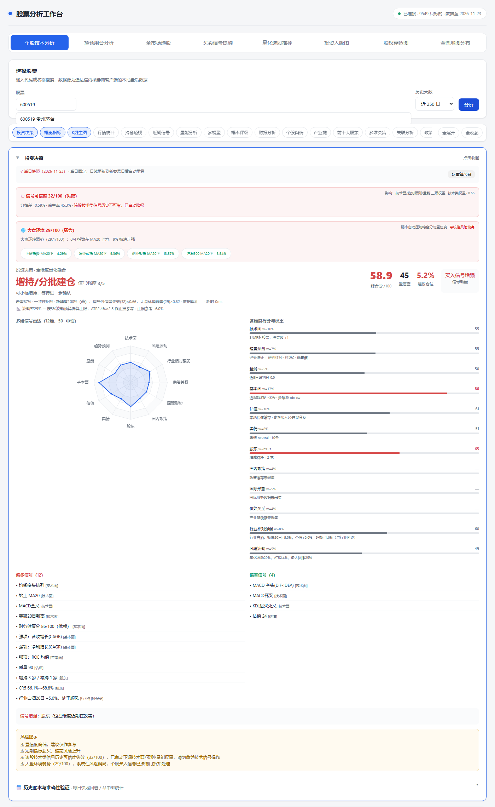
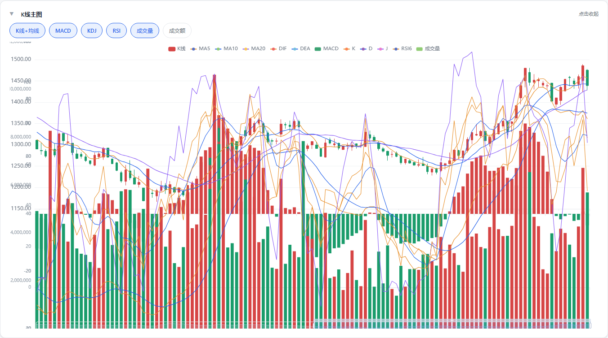
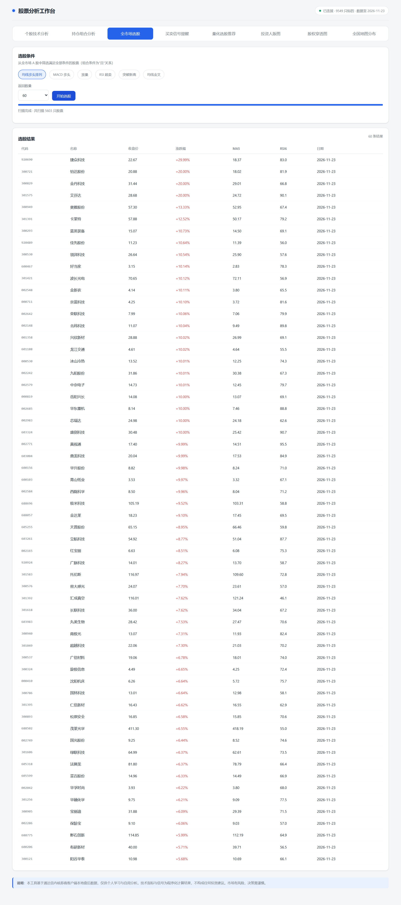
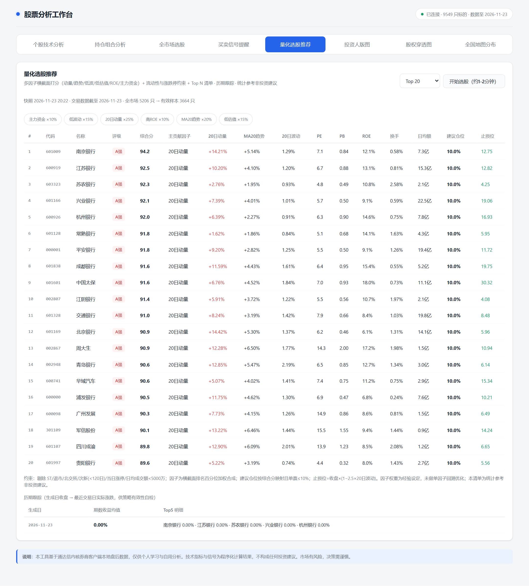
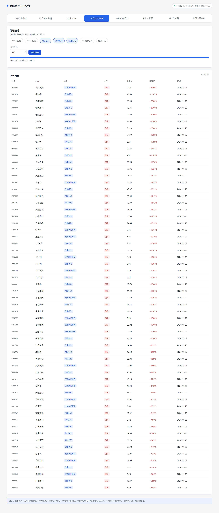
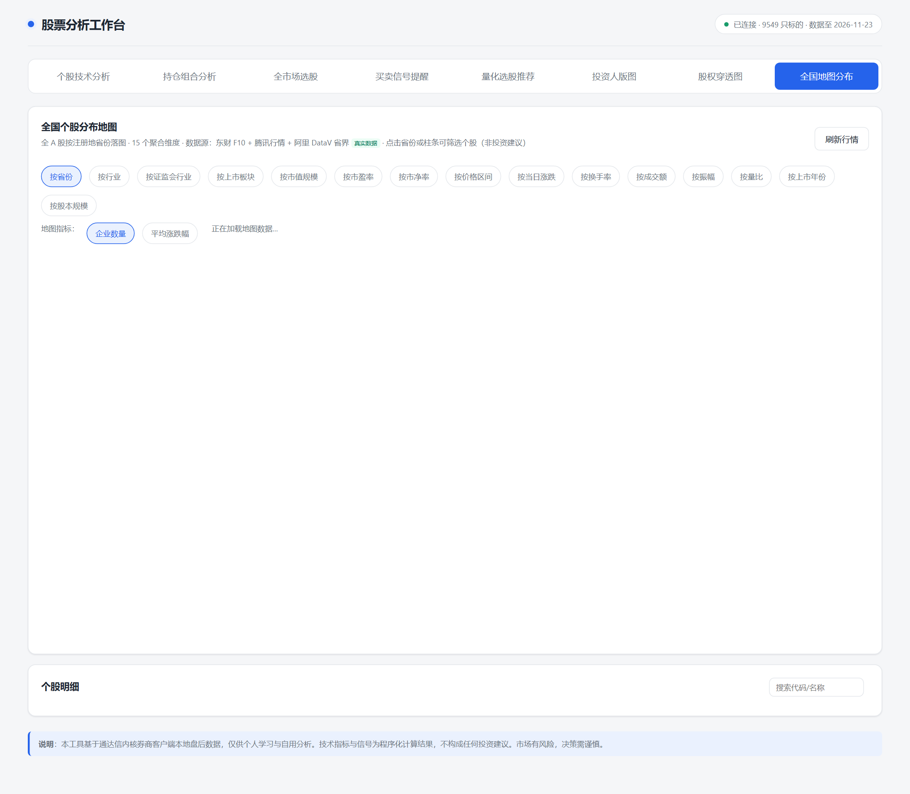

# 股票分析工作台（Stock Analyzer Workbench）beta0.1

基于通达信内核券商客户端本地盘后数据的个人股票分析与投资决策工具。纯本地运行，技术分析零联网；数据不上传，持仓加密存储。

A local stock analysis and decision-support workbench built on TDX-core broker client end-of-day data. All technical analysis runs offline; no data is uploaded, and portfolio holdings are stored encrypted.

> **版本**：beta0.1（首个公开预览版）
> **许可证**：Apache License 2.0
> **适用**：个人学习与自用分析，Windows 优先（数据源为本地客户端文件）

---

# 界面预览

> 以下截图均由本机真实运行截取，数据来源为本地客户端盘后文件（示例标的 600519、全市场 9549 只）。截图不含任何个人持仓、账户或隐私信息。

### 1. 投资决策引擎（12 维因子 + 可信度 + 市场环境闸门）



决策卡展示综合评分、操作建议、信号强度、建议仓位，以及雷达图、12 维因子分解、可信度概率、大盘环境四指数闸门、买入/卖出信号清单。每日快照落盘，可回看历史与验证命中率。

### 2. K 线主图与多指标副图



红涨绿跌（A 股习惯），叠加 MA5/10/20 均线与 MACD / KDJ / RSI / 成交量多子图，均基于本地日线纯前端计算。

### 3. 全市场选股



按均线多头排列、MACD 多头、放量、RSI 超卖等条件组合筛选，输出代码、名称、现价、涨跌幅、MA5、RSI6 等。

### 4. 量化选股推荐（多因子打分 + 历史回测）



Top N 排名含综合评分、主驱动因子、20 日动量、MA20 趋势、PE/PB/ROE、建议仓位与止损位，并附历史收益回测与约束说明。

### 5. 买卖信号提醒



扫描近 2 个交易日全市场技术信号，标注偏多/偏空方向、信号解释与审慎提示。

### 6. 全国地图分布



按省份/行业/板块等多维度的上市公司分布地图与排名，附明细表格。全部由本地客户端数据聚合。

---

# 功能介绍

## 一：个股技术分析

输入 6 位代码即可载入该股全部本地分析，120~1000 日可调。主要栏目：

```
1.K线主图 + MA / MACD / KDJ / RSI / BOLL / 成交量 / 成交额 副图切换
2.行情统计：振幅、量比、成交额、52周高低与距离、250日价格分位、
  5/20/60/250日区间涨幅、年初至今、连涨连跌、上涨占比、年化波动、
  未回补跳空缺口、BIAS / WR / ROC / OBV 扩展指标
3.近期信号：MACD 金叉死叉、均线金叉、突破、放量、KDJ、布林等，附逐条解释
4.持仓透视：该股在持仓中时展示成本 / 现价 / 盈亏 / 组合占比 / 对组合影响
5.页内完整分析链：舆情、产业链穿透、前十大股东、关联分析、政策分析、
  多维综合决策、投资决策引擎
6.15 个模块可折叠 + 锚点导航，默认只展开核心三项，首屏高度从 ~8800px 降到 ~2800px
```

## 二：投资决策引擎（核心能力）

把系统全部可量化信息融合为**买入 / 卖出 / 增持 / 减持 / 持有信号**，并给出信号增强 / 减弱归因。

```
1.十二维加权融合（各归一化 0-100，50 中性）：
  技术面15% / 趋势预测11% / 量能7% / 基本面17% / 估值10% / 舆情8% /
  股东6% / 国内政策4% / 国际形势5% / 供给关系4% / 行业相对强弱8% / 风险波动5%
2.两个调节器（不占权重）：
  - 信号可信度：历史回放的评分区分度 + 方向命中率，动态下调技术类三项权重（0.5~1.0）
  - 大盘环境闸门：4 大指数趋势 + 1119 个板块宽度，弱市向 50 收缩并压低置信度
3.建议仓位：按组合波动预算 3% 反推单票上限（2%~12%），ATR×2.5 给止损参考
4.综合分 → 7 档动作：强烈买入 / 买入 / 增持 / 持有 / 减持 / 卖出 / 强烈卖出
5.数据覆盖 <35% 或维度 <3 时强制「数据不足·观望」，不产生误导性信号
6.纯本地计算，零联网；实测单只 <3 秒
```

**每日快照与验证**：以本地日线最新交易日为 key 固化结果，可回看、可验证。

```
1.每日快照：当天首次查看生成并固化 data/decision_history/{code}.json，
  当天复用；新交易日自动生成下一份
2.历史账本：列出每份快照的动作 / 综合分 / 置信度，用真实后续收盘价
  回填 T+1/3/5/10 收益，随时间自然累积
3.历史信号回放：在本地日线上重放「技术面+量能」信号，统计方向命中率
  与评分区分度，快速检验择时逻辑（非完整十二维决策）
4.每日自动调度：服务启动 5 秒后自动跑一轮，持仓股优先且强制重算；
  每 5 分钟巡检，自然日变化 / 新交易日 / 持仓变化 / 当日快照缺失自动重跑
```

## 三：多账户持仓组合与加密存储

```text
1.多账户粒度：按 (账户, 代码) 合并重复录入；同股跨账户明细逐账户列示，
  另按代码合并展示各账户股数、合并市值与权重
2.账户管理：新增 / 重命名（同步改写持仓）/ 删除（转入其他账户或一并删除）
3.关系调整：单只整行迁移或按股数部分拆分（按原成本）；支持批量调整账户
4.权重口径：账户权重 / 个股权重 / 集中度均按最新市值，不含现金；
  重叠股票合并市值只计一次，避免多账户放大个股敞口
5.成本口径：全部持仓有成本才用总成本锚定净值，否则退化为区间起点归一化并告警
6.时间对齐：净值起点取所有持仓都有报价的共同交易日，晚上市股票显式列出
7.风险指标：Beta / 年化 Alpha / 跟踪误差 / 信息比率 / Sortino /
  历史法 VaR95 / CVaR95 / 日胜率 / 最差单日（相对上证指数 999999）
8.分散性检验：账户间日收益相关系数矩阵 + HHI 集中度；
  高度相关或重叠权重 >30% 时提示「多账户并未有效分散」
```

**持仓加密存储（安全设计）**：

```
密文：data/secure/portfolio.enc（Fernet = AES-128-CBC + HMAC-SHA256）
密钥：主密钥 os.urandom(32) 随机生成，不依赖机器码 / 口令 / 时间等任何因子
protect：Windows 上密钥落盘前经 DPAPI（CryptProtectData）加密，
         绑定当前 Windows 账户 + 应用固定熵；拷走密钥+密文到别的账户/机器也解不开
迁移：旧版明文 secret.key 首次读取时自动迁移，Fernet 密钥字节不变、密文无需重生成
兜底：每次写入前生成 .bak 加密备份，/api/holdings/restore 可恢复；
      密钥错误直接拒绝解密，绝不静默清空
注意：浏览器不留任何持仓副本；换电脑部署需重新绑定密钥（详见安装说明）
```

## 四：量化选股与信号提醒

```
1.选股条件：均线多头 / MACD多头 / 放量 / RSI超卖 / 突破新高 / 均线金叉等自由组合
2.信号扫描：全市场近期 MACD 金叉死叉、均线金叉、突破、放量、KDJ、布林等
3.后台任务 + 进度轮询，全市场约 5600 只需 1~2 分钟
```

**量化选股推荐**（个股页卡片）：六维横截面因子（20日动量25% / MA20趋势20% / 低波动15% / 低估值15% / ROE10% / 主力净额10%）→ 排名标准化 → 加权合成 → 实盘约束过滤（ST / 北交所 / 次新 / 涨停 / 低流动性）→ A/B/C/D 分级 → 建议仓位与止损位。每期落盘保留 24 期，自动回填历期实际涨跌供策略自检。**因子权重未做单因子回测优化，统计参考非投资建议。**

## 五：舆情、产业链与股东穿透

```
1.个股舆情：akshare 采集东财新闻(30min) / 公告(6h) / 研报(6h)，
  词典 + tanh 打情绪分（标题权重更高，研报评级独立信号），缓存优先、断网回退
2.产业链穿透：公司资料 / 主营 / 收入占比（巨潮+同花顺+东财F10）+ 概念板块，
  上中下游按板块语义规则映射并逐条标注「真实 / 推断·需核实」，
  合同中标公告来自巨潮一手披露；内置知识库示例，绝不臆造公司
3.前十大股东 + 多期深度分析：控制权结构 / 国资外资公募私募分类 /
  CR5-CR10 集中度趋势 / 增减持追踪 / 重点股东变动画像（规则推断）
4.股东穿透：点击股东名看控制链、自身经营、股息吸引力、证据链与公开报道；
  未收录主体降级为「待核实」，绝不编造动机
5.股东事件 × 舆情联动：把重点股东变动与新闻公告研报匹配，无直接报道时如实说明
```

合规采集：仅访问公开披露接口，全局最小间隔 1.2 秒、失败指数退避重试 2 次、缓存优先、本地审计留痕。用途仅限个人学习研究。

## 六：量能、多模型与概率评级

```
1.量能分析：量比五档状态 + 九类量价关系，近 10 日六维评分（-100~+100）
  输出强偏多 / 偏多 / 中性 / 偏空 / 强偏空研判
2.多模型购买参考：Piotroski F-Score / Altman Z 简化 / 格雷厄姆数字 / PEG /
  质量五维 / 海龟法则 / 格兰维尔八大法则 / 12-1 动量，雷达图 + 五档结论
3.下一交易日概率评级：kNN 历史条件统计（半衰期加权）+ 研判评分 Logistic 映射
  融合，给出上涨/下跌概率与 A~E 评级；样本不足标注「低置信」，
  两组概率分歧时全部如实展示。**非预测保证**
```

## 七：全国地图、投资人版图与关联分析

```
1.全国地图分布：全 A 股按注册地落中国地图，15 个聚合维度、双向筛选，
  点击省份/分类联动个股明细；东财 datacenter + 腾讯双稳定源，本地聚合零延迟
2.投资人版图：东财 F10 公开页采 5601 只 A 股实控人与前十大股东，
  实控人 → 控股平台 → 上市公司三层穿透 + 跨公司投资链条；
  实控人未披露如实标注，不拿第一大股东冒充
3.公告证据层：巨潮资讯年报原文 + 权益变动公告，PyMuPDF 解析股东章节，
  给穿透结论提供可点击的权威出处
4.股权穿透图：独立全屏页签，力导向大图漫游 + 节点详情 + 层级切换
5.关联分析：本地日收益 Pearson 相关 + 对沪深300 的 Beta / 超额收益 / 最大回撤，
  明确「统计相关 ≠ 因果」
6.政策分析：政策快讯 + 全球资讯规则映射主题情绪，标注「规则映射·需核实」
```

## 八：专业财务与分红（离线优先）

```
1.专业财务：解析通达信 vipdoc/cw/gpcw*.zip（20B头 + 11B/股索引 + float32），
  字段表来自 QUANTAXIS financial_dict，已与东财年报交叉验证；
  财报分析与选股 ROE 本地优先、东财兜底，无网络也可运行
2.分红画像：东财 LICO 全部报告期 + 本地总股本 + 本地不复权价，
  派生派息率 / 股息率 / 分红总额 / 连续分红年数，保留逐次派息明细
3.8 年财报分析：健康分纳入决策引擎基本面维度
```

## 九：数值精度与口径（已全量核对）

```
1.价格精度：股票 2 位、ETF/LOF 3 位，与通达信/券商报价一致
2.成交量：.day 的 volume 单位为股，展示万股，未做 100 倍误换算
3.BOLL：总体标准差 ddof=0 对齐主流行情软件；Beta 协方差 ddof=1
4.组合基准：默认上证指数 999999，不再误取深市平安银行
5.静态资源 no-store + 版本号，改动刷新即生效
```

---

# 技术栈

```
后端：Python 3.12 + Flask 3.0 + pandas 2.1 + numpy 1.26 + cryptography
前端：原生 HTML / JavaScript + ECharts 5.5（CDN）
指标：纯 pandas / numpy 实现，不依赖 TA-Lib
数据源：本地通达信内核客户端盘后文件 + akshare 公开接口（舆情/股东/政策等）
许可证：Apache License 2.0
```

---

# 安装说明

**beta0.1 仅支持 Windows**。一键安装会自动完成运行环境与依赖的安装，全程联网仅用于下载 Python 与依赖包，不上传任何本地数据。

## 一：一键安装（推荐，Windows 10 1809+ / Windows 11）

```
1. 下载源码 ZIP 并解压到任意目录（路径建议不含中文与空格）。
2. 双击根目录下的「一键安装.bat」，脚本自动依次完成：
   - 检测 Python 3.12+，缺失则用 winget 静默安装 Python 3.12
   - 在项目内创建独立虚拟环境 venv\（不污染系统 Python）
   - 从阿里云镜像安装 requirements.txt 全部依赖
   - 在桌面创建「股票分析工作台」快捷方式
   - 启动后台服务并自动打开 http://127.0.0.1:8899
3. 等待数秒，页面出现即可使用。首次启动会读取随包附带的股票名称表
   （data/stock_names.json），无需再解析客户端，秒级进入。
```

前提条件：本机需安装**任意通达信内核券商客户端**并下载盘后数据（见下节）。winget 需要 Windows 10 1809+ 或 Windows 11；若系统无 winget，脚本会提示手动安装 Python 后重跑。

日常使用只需双击桌面快捷方式（指向「启动分析工具.bat」）；停止服务运行「停止服务.bat」。

## 二：手动安装（可选，或用于非 Windows）

```bash
# 1. 安装 Python 3.12（https://www.python.org/downloads/ ，勾选 Add to PATH）
# 2. 创建虚拟环境（可选）
python -m venv venv
venv\Scripts\activate

# 3. 安装依赖（国内镜像）
python -m pip install -r requirements.txt -i https://mirrors.aliyun.com/pypi/simple/

# 4. 启动
python backend\app.py --port 8899
```

`akshare` 与 `PyMuPDF` 为延迟导入：未安装时本地技术分析仍可用，仅舆情 / 公告证据等联网模块不可用。

## 三：本地客户端数据准备（关键前提）

```
安装任意通达信内核券商客户端并下载盘后数据：
  - 日线文件：vipdoc\{sh,sz,bj}\lday\*.day（32 字节/条）
  - 名称缓存：T0002\hq_cache\{shs,szs,bjs}.tnf（GBK）
  - 专业财务：vipdoc\cw\gpcw*.zip（用客户端「专业财务数据下载器」下载）
  - 自选股：T0002\blocknew\zxg.blk（可选，用于导入持仓）
默认探测常见客户端安装根目录（C:\zd_gjzq、C:\new_tdx、D:\new_tdx 等）；
如安装在别处，修改 backend/tdx_reader.py 的 CANDIDATE_ROOTS，
或用环境变量 TDX_CW_DIR 覆盖财务数据目录。
```

## 四：持仓与密钥注意事项

```
1.持仓首次使用：在「持仓组合」页添加，数据写入服务端加密文件，
  浏览器不保留副本。旧版 localStorage 持仓首次打开会自动迁移并清除。
2.密钥位置：Windows 为 %APPDATA%\StockAnalyzer\secret.key（DPAPI 保护），
  可用 STOCK_KEY_FILE 指定其他路径，或 STOCK_SECRET 直接提供 base64 密钥。
3.换电脑部署：DPAPI 绑定当前 Windows 账户，旧密钥文件拷到新机器解不开。
  请在新机器删除旧密钥文件让系统重新生成，再用 /api/holdings/sync 重新导入持仓；
  或导出旧密钥后写入新机器密钥文件（会被自动封装为新机器的 DPAPI 格式）。
4.误覆盖恢复：POST /api/holdings/restore 用 portfolio.enc.bak 恢复上一版。
5.data/ 目录除随包附带的股票名称表（公开的全市场代码-名称映射）外，
  其余缓存、持仓密文、决策历史均为运行时生成，不随源码分发。
```

## 五：目录结构

```
stock-analyzer/
├── backend/              # Flask 后端与分析模块
│   ├── app.py            # 路由与服务入口
│   ├── tdx_reader.py     # 通达信本地数据读取
│   ├── decision_engine.py / decision_history.py / daily_runner.py
│   ├── portfolio_analysis.py / secure_store.py
│   ├── chain_reader.py / holder_reader.py / news_reader.py / ...
│   └── knowledge/        # 产业链知识库
├── frontend/             # 原生前端（index.html + app.js）
├── data/
│   ├── stock_names.json  # 随包附带的全市场股票名称表（公开数据）
│   └── secure/           # 加密持仓密文（运行时生成，不随仓库分发）
├── 一键安装.bat          # Windows 一键安装（Python/依赖/快捷方式/启动）
├── 启动分析工具.bat      # 日常启动
├── 停止服务.bat          # 停止后台服务
├── requirements.txt
├── LICENSE
├── RELEASE_NOTES.md
└── README.md
```

## 六：主要接口

```
GET  /api/status                     数据源状态
GET  /api/stock/<code>?days=         个股历史 + 指标 + 信号
POST /api/portfolio                  多账户持仓组合分析
POST /api/screen  /api/signals       选股 / 信号扫描（返回 job_id）
GET  /api/decision/<code>            投资决策（每日快照）
GET  /api/decision/history/<code>    快照账本
GET  /api/decision/accuracy/<code>   准确性验证（回填 + 历史回放）
GET  /api/decision/autorun/status    自动决策状态
GET  /api/holdings                   读取加密持仓
POST /api/holdings/sync              保存加密持仓
GET  /api/predict/<code>             次日概率评级
GET  /api/controllers/*              投资人版图穿透
GET  /api/job/<job_id>               异步任务进度
```

完整接口清单见源码 `backend/app.py`。

---

# 特别声明

```
1.股市有风险，投资需谨慎。本系统仅供个人学习、研究与技术分析使用，
  所有输出均为公开数据 / 本地数据的程序化计算结果，不构成任何投资建议，
  不输出目标价，不承诺收益，投资盈亏概不负责。
2.评分、信号、概率、仓位建议均为规则化 / 统计化参考刻度，不是预测保证；
  历史命中不代表未来表现；报告期滞后、词典映射、板块语义推断等局限
  在各模块输出中均已标注。
3.产业链方向、股东动机、政策影响等「推断」内容为规则映射，
  非一手披露，需核实原文与官方公告。
4.数据来自第三方公开接口与本地客户端文件，请遵守相关网站服务条款，
  仅用于个人学习研究，不分发、不商用。
5.本项目采用 Apache License 2.0 开源，作者不对使用后果承担责任。
```
